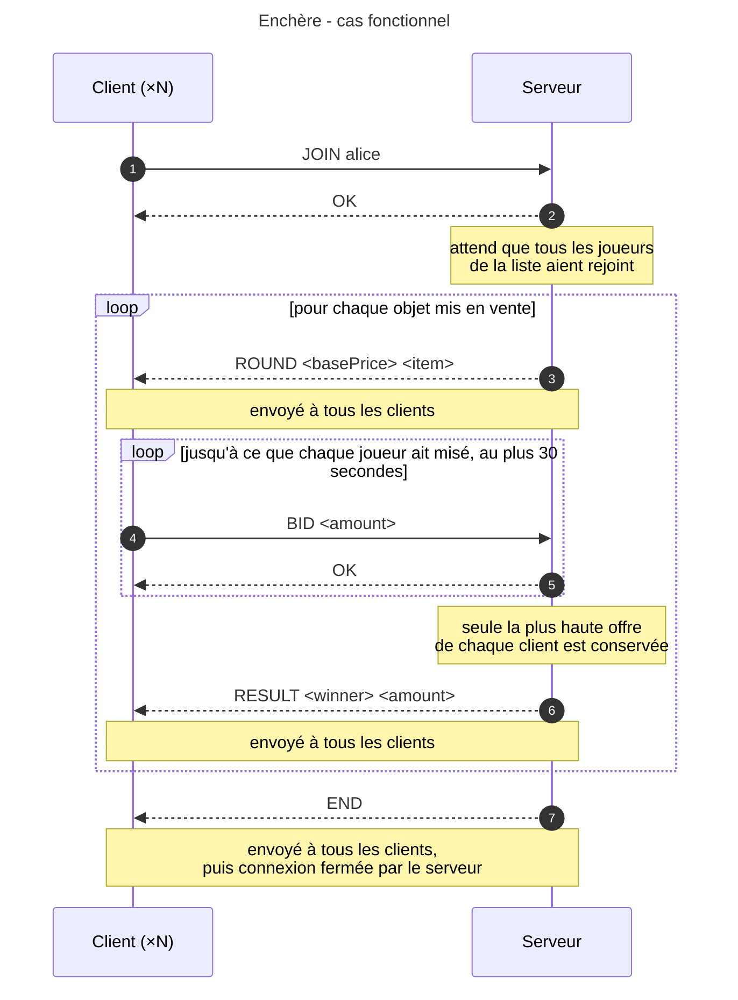
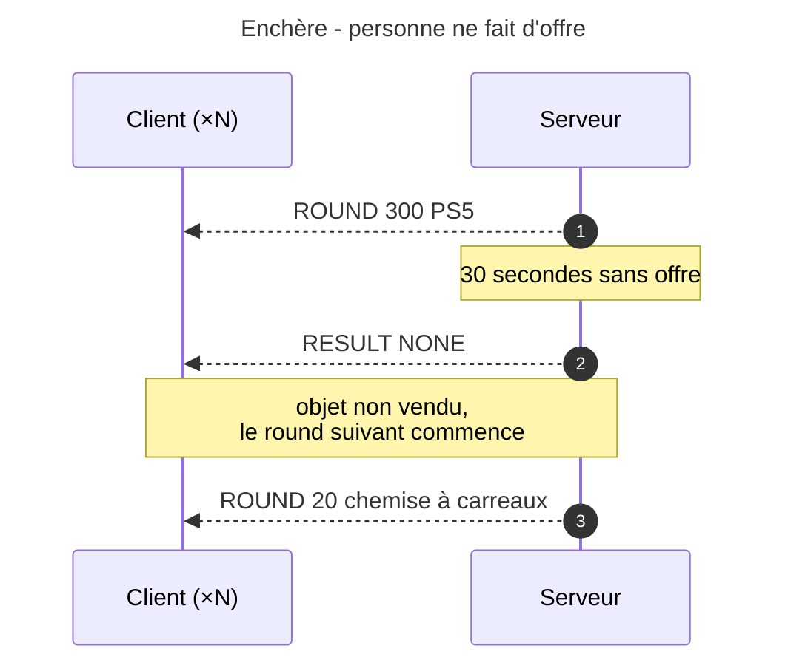
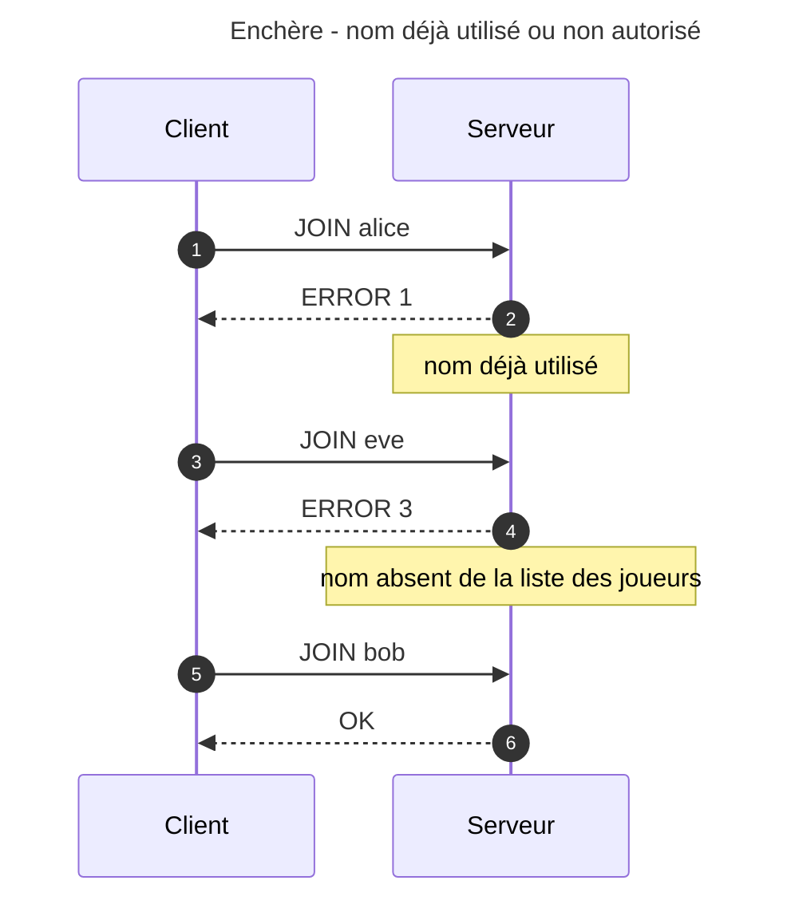
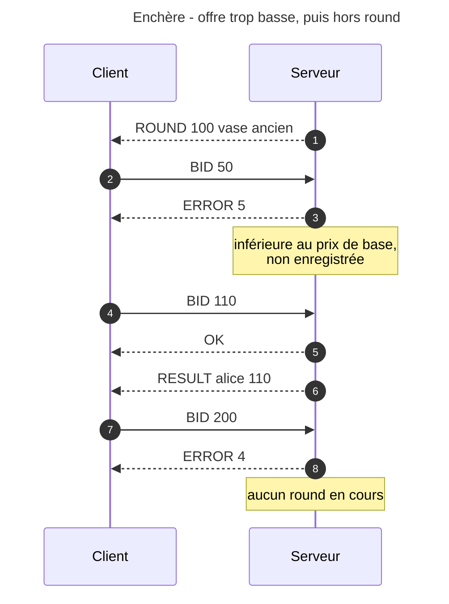
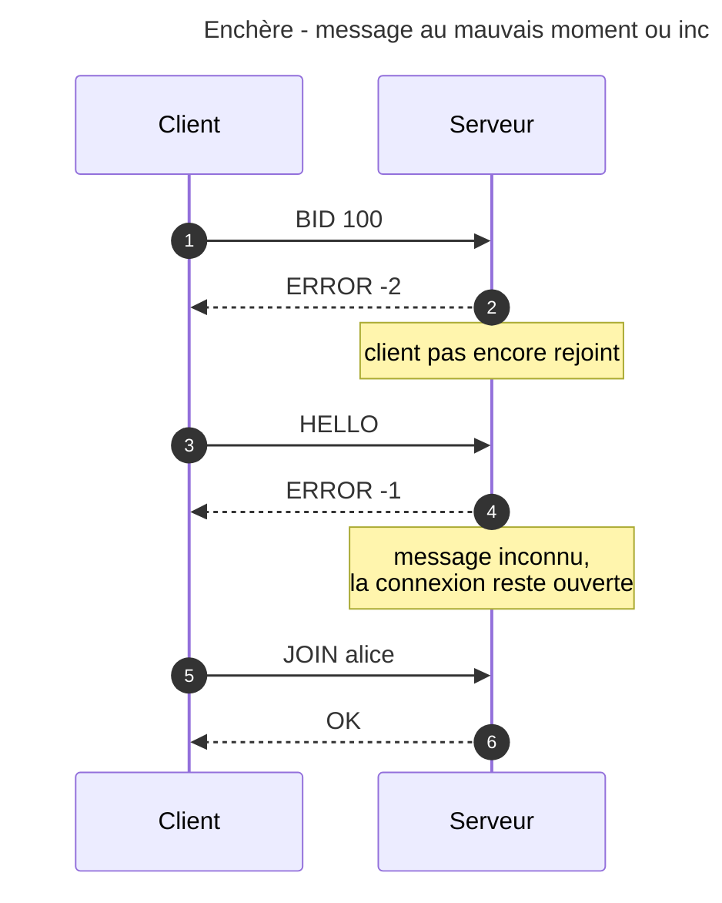

# AMP - Auction Message Protocol

## Aperçu

Le protocole AMP (Auction Message Protocol) permet à des joueurs, chacun avec un nom unique, de participer à des enchères dirigées par un serveur. 

Le serveur met en vente un objet par round - chaque joueur propose un montant sans voir les offres des autres - à la fin du round, le serveur annonce le plus offrant à tous les joueurs.

## Protocole de transport

Le protocole AMP utilise TCP, pour qu'aucune offre ne soit perdue. Le serveur écoute sur le port 6436.

Chaque message est encodé en UTF-8 et se termine par un caractère de fin de ligne (`\n`). Les paramètres sont séparés par un seul espace. Les mots-clés sont écrits en majuscules et sensibles à la casse.

La liste des joueurs autorisés est fixée au démarrage du serveur.

Le client ouvre la connexion et parle en premier, avec un message `JOIN`. Le serveur vérifie que le nom figure dans la liste des joueurs et qu'il n'est pas déjà utilisé.

La vente commence quand tous les joueurs de la liste ont rejoint.

Les objets sont vendus l'un après l'autre, un par round. Au début d'un round, le serveur envoie `ROUND` à tous les joueurs connectés. Le round se termine dès que chaque joueur a fait une offre, ou au plus tard après 30 secondes. 

Le serveur envoie alors `RESULT` à tous les joueurs connecté, et le round suivant commence aussitôt. Un joueur n'est pas obligé de faire une offre : celui qui n'en a fait aucune après 30 secondes ne participe simplement pas à ce round.

Après le dernier round, le serveur envoie `END` à tous les joueurs connectés, puis ferme les connexions.


Sur un message inconnu, ou un message dont un paramètre manque ou est invalide, le serveur répond `ERROR -1`. Sur un message valide autre que `JOIN` d'un client qui n'a pas rejoint, il répond `ERROR -2`. Dans les deux cas, la connexion reste ouverte.

Si un client ferme la connexion, le serveur cesse simplement de lui envoyer des messages.


| Code | Signification |
|---|---|
| `-1` | Message inconnu, ou paramètre manquant ou invalide |
| `-2` | Le client n'a pas encore rejoint |
| `1` | Le nom est déjà utilisé |
| `2` | Ce client a déjà rejoint |
| `3` | Le nom ne figure pas dans la liste des joueurs |
| `4` | Aucun round n'est en cours |
| `5` | L'offre est inférieure au prix de base |

## Messages

### Rejoindre la vente

Le client demande à rejoindre la vente sous un nom.

#### Requête

```text
JOIN <name>
```

- `name` : le nom du joueur, un mot sans espace, présent dans la liste des joueurs du serveur

#### Réponse

- `OK` : le client a rejoint la vente
- `ERROR <code>` : le client n'a pas rejoint. Codes : `1`, `2`, `3`


### Message inconnu ou invalide

Le serveur répond à tout message qu'il ne peut pas traiter.

#### Réponse

- `ERROR -1` : le message est inconnu, ou un paramètre manque ou est invalide
- `ERROR -2` : le message est valide, mais le client n'a pas encore rejoint

La connexion reste ouverte dans les deux cas.

### Annoncer un round

Le serveur annonce un nouveau round à tous les joueurs connectés.

#### Requête

```text
ROUND <basePrice> <item>
```

- `basePrice` : le prix de base
- `item` : le nom de l'objet

#### Réponse

Aucune.

### Faire une offre

Le client propose un montant pour l'objet du round en cours.

#### Requête

```text
BID <amount>
```

- `amount` : le montant proposé

#### Réponse

- `OK` : l'offre est enregistrée. Si le joueur avait déjà fait une offre plus haute, celle-ci est conservée
- `ERROR <code>` : l'offre n'est pas enregistrée. Codes : `4`, `5`

Le serveur vérifie les codes dans l'ordre `4`, `5`.

### Annoncer le résultat

Le serveur annonce la fin du round à tous les joueurs connectés.

#### Requête

```text
RESULT <winner> <amount>
RESULT NONE
```

- `winner` : le nom du plus offrant
- `amount` : son offre
- `NONE` : aucune offre n'a été enregistrée ; l'objet n'est pas vendu

En cas d'égalité, le gagnant est celui qui figure en premier dans la liste des joueurs du serveur.
#### Réponse

Aucune.

### Fin de la vente

Le serveur annonce à tous les joueurs connectés que tous les objets ont été vendus.

#### Requête

```text
END
```

#### Réponse

Aucune.


## Exemples

### Exemple fonctionnel




### Round sans offre



### Erreurs à la connexion



### Erreurs sur les offres



### Message avant de rejoindre, et message inconnu


  